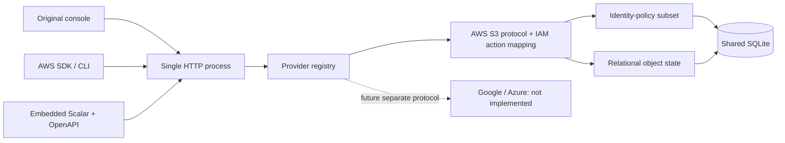

# Go standalone runtime: initial S3 increment

Status: implemented in PR #26 and recovered for required-check verification on an independent branch. Replaces the TypeScript runtime intentionally. No deployment or release is part of this work.

## Outcome and boundaries

One Go process embeds an original console, Scalar 1.76.4, OpenAPI, dependency notices, and SQLite. Static binaries use CGO_ENABLED=0. The console issues the exact same S3 requests as SDK clients. Scalar executes those wire APIs directly. No AWS infrastructure, workloads, SSH server, Node, Docker, or external database is started.

The first usable flow is bucket creation → object upload → read/download → delete object → delete empty bucket. FK ownership, nonempty deletion, policy decisions, and atomic conditional writes are exercised in concrete tests. Problems/scenarios/grading stay outside this repository.

## Multi-cloud extension boundary

`internal/provider.Registry` accepts independently implemented handlers. AWS is currently the default root wire endpoint and is also mounted under `/_simulator/providers/aws/`. Additional providers can coexist under their own provider prefixes, with no single-provider boot mode. A test registers two independent handlers and verifies coexistence and routing isolation. Only AWS is advertised as implemented.

`internal/core` imports no provider package or provider dispatch literal. It currently supplies relational object storage and a limited identity-policy matching primitive used by AWS. This is not a universal cloud IAM abstraction. A new provider must own its native protocol, resource types and relationships, authorization rules, and console. Sharing hosting/database transactions does not imply inheriting S3 ARN/policy semantics or the AWS console.

Current state is **one simulated AWS account**. S3 names are global within that account; bucket region is a property, not a separate namespace, as in S3. General multiple-provider/account namespaces and cross-cloud relations are a future schema migration; they are not implemented. New provider resources must use provider-owned tables or explicit provider/account keys before registration; they must never silently reuse the AWS object namespace. Future event/fault/scenario adapters can call this state layer, but there is no existing fault injection, grading, log/metric fidelity, or cross-cloud synchronization claim.

## Storage and transaction model

SQLite tables: `buckets(name PK, region, created)`, `objects(bucket FK RESTRICT, key, data, etag, modified, content_type, PK(bucket,key))`, `identity_policies(name PK, document)`. Schema version 1 is recorded in user_version. Unversioned nonempty and unknown future databases are rejected. There is no migration from the old TypeScript snapshots.

Each process uses one SQL connection. Transactions begin immediately; a 5-second busy timeout supports explicitly shared-file writers. Limits and conditional overwrite checks execute in the same transaction as writes. Foreign keys are enabled per connection. API tests exercise errors and successful transitions; core tests also bypass Store once to verify the database itself rejects an orphan. Cross-process crash/power-loss recovery is not tested. Use one database per exercise/CI job for isolation, not principal headers.

Default `:memory:` resets on exit; `--state /path/to/file.db` persists bytes and identity policies through restart. State paths are explicit filenames, not SQLite URI configuration. Database files created by the simulator use mode 0600. Errors are logged and returned as failures; a failed database query never becomes an empty successful listing.

## Authentication versus IAM

Requests can be unsigned. Signed SDK requests accept dummy TCSIM access keys without checking signatures. Real key shapes, session tokens, and presigned requests are rejected. The default simulator-admin is a local unrestricted setup identity. It is not modeled as an AWS root user's policy behavior.

For exercises, x-simulator-principal chooses the identity policy. A matching explicit Deny wins, matching Allow permits, otherwise implicit Deny applies. Action matching ignores case; resource matching preserves case. Only Effect/Action/Resource/Sid and Version 2012-10-17 are accepted. Conditions, Principal, NotAction, NotResource, boundaries, sessions, resource policies, and SCPs are rejected. Header selection is not authentication and must not be exposed as a multi-user security service. Administrative JSON policy APIs are not AWS IAM Query emulation.

## API fidelity and known differences

OpenAPI represents the actual S3 paths and methods. GET /{bucket} combines ListObjectsV2 and GetBucketLocation because S3 chooses operations using query parameters. The description explains the distinction rather than presenting invented wire paths. ListObjectsV2 is the supported listing version. Continuation tokens are opaque scoped cursors over a fresh snapshot per request; concurrent mutations between pages do not freeze a listing.

Supported data integrity inputs: Content-MD5 and SHA1/SHA256/CRC32/CRC32C headers. Unsupported options fail rather than pretending to configure encryption, ACLs, metadata, multipart uploads, or versioning. Content-Disposition forces downloaded object data to attachments; uploaded HTML is not rendered as part of the console.

Known differences: all duplicate bucket creates currently return 409 (including us-east-1, where AWS historically has a 200 special case); names reject control characters in keys; only four regions and general-purpose buckets; single-account identity policy subset only; no bucket pagination, owner model, user metadata, object version IDs, service billing or real network/compute behavior. The simulator limits payload storage to 64 MiB; whole-process resident memory includes SQLite/Wasm and transient HTTP buffers.

## Sources and validation scope

Primary protocol references consulted on 2026-11-03:

- https://docs.aws.amazon.com/AmazonS3/latest/API/API_ListObjectsV2.html
- https://docs.aws.amazon.com/AmazonS3/latest/API/API_PutObject.html
- https://docs.aws.amazon.com/AmazonS3/latest/API/API_DeleteBucket.html
- https://docs.aws.amazon.com/IAM/latest/UserGuide/reference_policies_evaluation-logic.html
- boto3 1.42.0 / botocore 1.41.6 service model in pinned development dependencies; `reports/sdk-model.json` records the local model version and digest.

No cloud-owned source code, console assets, logos, screenshots, or docs prose was copied into the UI/specification. No Kumo fork is used. Scalar and actual Go dependency licenses are retained and embedded. The formerly unresolved Replit color-picker dependency is excluded from the locally rebuilt bundle; only CSS color swatches are omitted. Original notices for all actual bundle inputs are retained. The original upstream standalone JS is no longer shipped.

TLC 1.7.4 checked the finite resource/IAM abstraction and detected a deliberate nonempty-delete mutant. Go tests separately exercise HTTP, state constraints, policy parsing/evaluation, concurrent writers and persistence. This is not a refinement proof of Go/SQLite, exhaustive cloud conformance, or proof of full IAM semantics.

## Compatibility and recovery

Removed: the old Bun packages, Docker runtime, provider emulations, world/deployment/snapshot protocol, Symphony tools, and TypeScript-specific harness/build/CI configuration. Their source and tests remain available in Git history at base 256dc8384a724e2a8a684986a97bb05f7944ad67. New CI exercises the actual replacement runtime; it does not waive the old runtime's tests while claiming those features remain.

TenkaCloud and TenkaCloudChallenge were not edited. Consumers must use this increment's capability manifest and a future explicit adapter; existing cross-repository integration is not compatible yet. Rollback is the pre-change Git revision; review all replacement deletions as a deliberate scope decision before merging. macOS uncommitted work was not accessed, moved, or overwritten. No Mac files were required because this implementation is independently built from remote main.

Scalar integration keeps a strict no-eval script policy. The vendored Zod 4.6.7 optional eval probe is disabled by its jitless global configuration in a separate local boot script before Scalar loads; browser tests assert no CSP violations or external requests.
